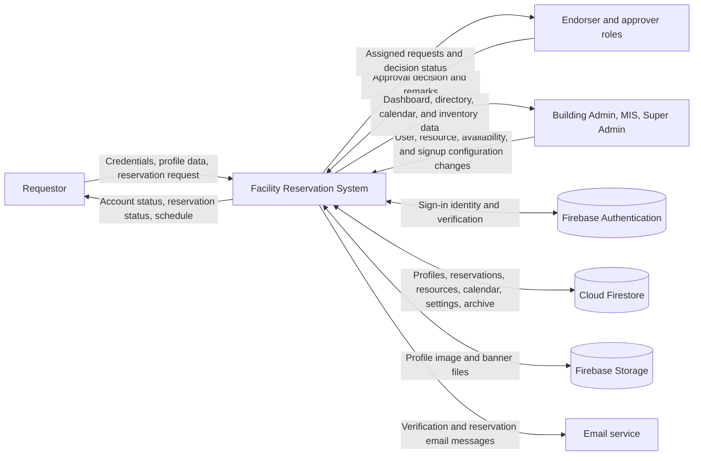
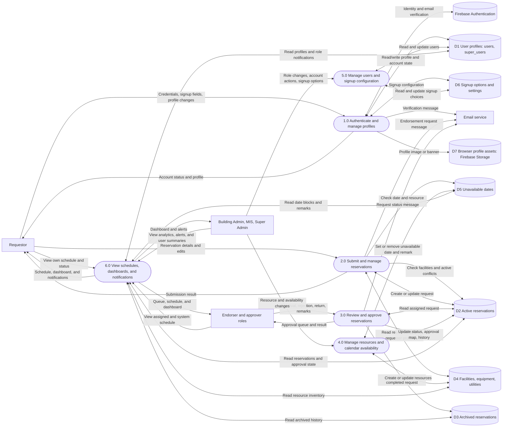
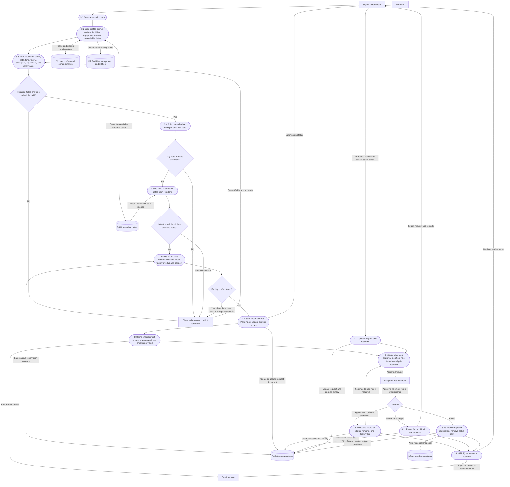
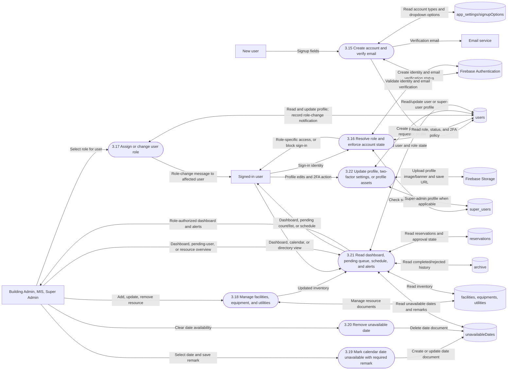

# Facility Reservation System Context and Data Flow

This document describes the current application as implemented in the
repository. It uses Mermaid flowcharts to represent a context diagram (Level 0)
and progressively decomposed data-flow diagrams (Levels 1-3).

## Notation and scope

- Rectangles represent external entities.
- Rounded nodes represent processes.
- Cylinders represent data stores or external services.
- Arrows represent data moving between entities, processes, and stores.
- Firestore relationships and process boundaries reflect application behavior;
  they are not security-rule or deployment-boundary guarantees.
- Email is sent through the configured email service integration. Firebase
  Authentication, Firestore, and Storage are external managed services from
  the application's point of view.

## Level 0 - Context diagram

The whole reservation application is represented as one process.

## Level 1 - System processes and data stores

## Level 2 - Reservation lifecycle decomposition

This expands process 2.0 and shows how a request is validated, saved, reviewed,
and eventually archived.

```mermaid
flowchart LR
    Requestor[Requestor]
    Approver[Endorser and approval roles]
    EmailService[Email service]

    P21([2.1 Enter event, dates, people, and resources])
    P22([2.2 Load current resource and calendar data])
    P23([2.3 Validate required fields and date range])
    P24([2.4 Exclude unavailable dates])
    P25([2.5 Check facility time and capacity conflicts])
    P26([2.6 Save or update reservation])
    P27([2.7 Route request for endorsement and approval])
    P28([2.8 Record decision and notify requester])
    P29([2.9 Archive rejected or completed request])

    D1[(User profiles)]
    D2[(Facilities, equipment, utilities)]
    D3[(Unavailable dates)]
    D4[(Active reservations)]
    D5[(Archived reservations)]

    Requestor -->|Event and reservation fields| P21
    P21 -->|Requested resources and date range| P22
    P22 <-->|Read inventory and facility limits| D2
    P22 <-->|Read calendar date blocks| D3
    P22 -->|Profile and resource context| P23
    D1 -->|Current user and requester role| P23
    P23 -->|Valid request| P24
    P23 -->|Missing or invalid field feedback| Requestor
    P24 <-->|Unavailable date IDs and remarks| D3
    P24 -->|Daily schedule with unavailable dates excluded| P25
    P25 <-->|Compare active reservations and facility use| D4
    P25 -->|Conflict details| Requestor
    P25 -->|Validated schedule and request| P26
    P26 <-->|Create, edit, or resubmit request| D4
    P26 -->|Submission confirmation| Requestor
    P26 --> P27
    P27 -->|New endorsement request| EmailService
    P27 -->|Request enters assigned approval queue| Approver
    Approver -->|Approve, reject, return for modification, remarks| P28
    P28 -->|Update status, approval map, and history| D4
    P28 -->|Decision notification| EmailService
    P28 -->|Decision and remarks| Requestor
    P28 -->|Rejected reservation snapshot| P29
    P29 -->|Write archive snapshot and remove active record| D5
    P29 -->|Completed approved reservation snapshot| D5
```

## Level 3 - Detailed request submission and approval flow

This expands validation and decision processing. The active application checks
unavailable dates and facility conflicts again during submission to avoid
relying only on potentially stale client state.

## Level 3 - Administration, calendar, and account lifecycle

## Operational notes

- A signup can create a regular user profile with a `pending` role when the
  selected account type maps to faculty. Email verification is required before
  normal sign-in; Super Admin is looked up in its separate collection.
- Role-change messages are carried on profile data. Pending-user alerts and
  dashboard counts are computed from user profiles, rather than stored in a
  standalone notification collection.
- MIS and Building Admin can review pending users, while assignment of the
  `pending` role is restricted to Super Admin.
- Calendar unavailability records contain a date and administrator remark.
  Reservation submission excludes unavailable days while retaining other days
  in the requested date range.
- The approval process updates the active reservation through approval roles.
  Rejected and completed reservations may be moved into the archive.
- Firestore data is schemaless. The named stores and flows represent current
  application usage, and do not imply relational constraints or authorization
  rules.
