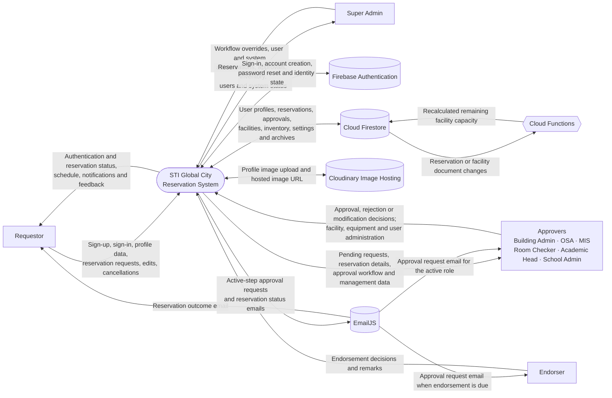

# System Context Flow Diagram

This context-level diagram shows the people and external services that exchange
information with the STI Global City Reservation System. It is inferred from
the current client and Cloud Functions code. Firestore collections and internal
processes are intentionally grouped at this level.

## Flow notes

- **Requestors** create and update their reservations, view schedules, and
  receive workflow outcomes.
- **Endorsers and approvers** act on reservation requests. Approval capability
  depends on role and the configured approval sequence; super admins can
  override the normal sequence.
- **Firebase Authentication** handles account identity and authentication.
  Role/profile records are maintained separately in Firestore.
- **Cloud Firestore** stores the application's operational records, including
  `users`, `super_users`, `reservations`, `archive`, `facilities`, `equipments`,
  `utilities`, `unavailableDates`, `pending_profiles`, and
  `app_settings/signupOptions`.
- **Cloud Functions** listen for reservation and facility writes and recalculate
  facility remaining capacity.
- **Cloudinary** hosts profile images; the application stores the resulting
  image URLs in user/profile records.
- **EmailJS** sends approval requests only to the currently active approval
  step, then notifies the next step as the reservation advances. It also sends
  reservation outcome emails to requestors.
