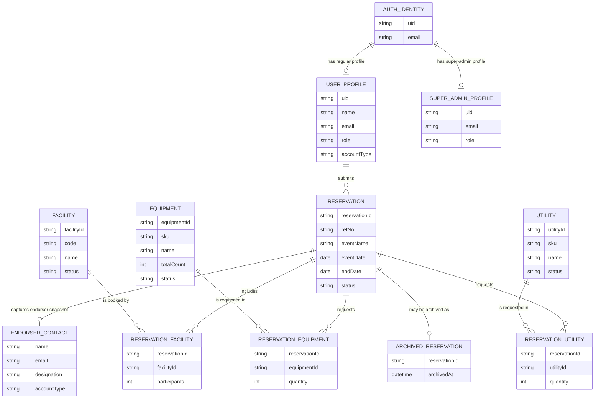

# Facility Reservation System ERDs

These diagrams describe the application as implemented in the repository. The
logical ERD shows the domain relationships independently of storage. The
physical ERD reflects the current Firebase Authentication and Cloud Firestore
layout.

## Scope and interpretation

- Firestore collection/document fields are inferred from the client and Cloud
  Functions code; Firestore does not enforce a fixed schema.
- Relationship lines in the physical ERD show IDs stored by application
  convention. They are not Firestore-enforced foreign keys.
- Embedded arrays and maps remain inside their parent document; they are not
  separate collections.
- `users` and `super_users` are profile documents associated with Firebase
  Authentication identities. Super-admin records are maintained separately.
- Reservation approval history, approval state, facility participation, and
  resource selections are embedded in reservation documents.
- A rejected reservation may be moved from `reservations` to `archive`, keeping
  its document ID. The archive is a historical copy/snapshot, not a second
  active reservation.
- Pending-user notifications are derived from user records and role-change
  notification data is stored on the user profile; there is no separate
  notifications collection.
- Profile images and banners are stored outside Firestore; their URLs are
  stored on profile documents.

## Logical ERD

This conceptual view uses associative entities for the reservation-to-resource
many-to-many relationships. These associations are embedded in Firestore in
the physical model.

`UNAVAILABLE_DATE` is intentionally not related to a reservation: it is
calendar-wide availability data used to exclude dates during reservation
creation. `SIGNUP_CONFIGURATION` is a singleton configuration rather than a
user-owned entity.

## Physical ERD (Firebase)

```mermaid
erDiagram
    AUTH_IDENTITY ||--o| USERS : "uid / profile"
    AUTH_IDENTITY ||--o| SUPER_USERS : "uid / profile"
    USERS ||--o{ RESERVATIONS : "userId (snapshot)"
    RESERVATIONS }o--o{ FACILITIES : "facilities[] IDs"
    RESERVATIONS }o--o{ EQUIPMENTS : "selectedEquip map keys"
    RESERVATIONS }o--o{ UTILITIES : "selectedUtilities[] IDs"
    RESERVATIONS ||--o| ARCHIVE : "same document ID when archived"

    AUTH_IDENTITY {
        string uid PK
        string email
    }
    USERS {
        string uid PK
        string email
        string name
        string firstName
        string middleInitial
        string lastName
        string role
        string accountType
        string studentNumber
        string course
        string department
        map signupDropdown
        map customAttributes
        array customFields
        boolean emailVerified
        string phone
        string officeLocation
        string status
        string lastActive
        string activeSessionId
        boolean twoFactorEnabled
        string twoFactorSecret
        string avatarUrl
        string bannerUrl
        string timeCreated
        map roleChangeNotification
        string approvalView
    }
    SUPER_USERS {
        string uid PK
        string email
        string name
        string role
        boolean twoFactorEnabled
        string twoFactorSecret
        string avatarUrl
        string bannerUrl
    }
    RESERVATIONS {
        string documentId PK
        string refNo
        string userId
        string userEmail
        string userRole
        string fullName
        string eventName
        array requestorTypes
        map requestorAttributes
        string studentNumber
        string department
        string contactNumber
        string emailAddress
        string endorserAccountType
        map endorserAttributes
        int expectedParticipants
        array eventType
        string purpose
        array facilities
        string specificRoom
        int specificRoomParticipants
        map facilityParticipants
        date eventDate
        date endDate
        int days
        string startTime
        string endTime
        array schedule
        number durationHours
        boolean aircon
        string airconOnTime
        string airconOffTime
        map selectedEquip
        array selectedUtilities
        map selectedUtilityUnits
        string otherEquipment
        string otherUtility
        string endorserName
        string endorserEmail
        string endorserDesignation
        string status
        map approvals
        array historyLogs
        string modificationRemark
        string modificationRequestedBy
        string modificationRequestedByRoleKey
        string modificationRequestedAt
        string rejectionRemark
        string createdAt
        string updatedAt
    }
    ARCHIVE {
        string documentId PK
        string refNo
        string userId
        string userEmail
        string eventName
        date eventDate
        date endDate
        string status
        map approvals
        array historyLogs
        string archivedAt
    }
    FACILITIES {
        string documentId PK
        string code
        string name
        string location
        int minCapacity
        int maxCapacity
        int remainingCap
        string status
        string statusClass
        string lastUpdated
    }
    EQUIPMENTS {
        string documentId PK
        string name
        string sku
        int availableCount
        int totalCount
        string status
        string statusClass
        string lastUpdated
    }
    UTILITIES {
        string documentId PK
        string name
        string sku
        string status
        string statusClass
        string lastUpdated
    }
    UNAVAILABLE_DATES {
        string dateId PK
        date date
        string remark
        string updatedAt
        string updatedBy
    }
    SIGNUP_CONFIGURATION {
        string documentPath PK
        array accountTypes
        array courses
        array departments
        array dropdownTypes
    }
```

### Firestore paths and embedded structures

| Firestore path | Document key | Stored data / notes |
| --- | --- | --- |
| `users/{uid}` | Firebase Auth UID | Regular user profile, role, signup attributes, verification and online status, optional 2FA fields, profile image URLs, and role-change notification data. Fields are optional and have evolved over time. |
| `super_users/{uid}` | Firebase Auth UID | Separate Super Admin profile collection. The application reads and updates this collection for Super Admin profiles. |
| `reservations/{reservationId}` | Firestore-generated ID | Request and event details, requester/endorser snapshots, date and daily schedule, approval workflow, status, and resource selections. |
| `archive/{reservationId}` | Original reservation ID | Archived reservation snapshot, including approval and history data and `archivedAt`. |
| `facilities/{facilityId}` | Firestore-generated ID | Facility identity, location, capacity limits, derived remaining capacity, and operational status. |
| `equipments/{equipmentId}` | Firestore-generated ID | Equipment identity, SKU, stock counts, and status. |
| `utilities/{utilityId}` | Firestore-generated ID | Utility identity, SKU, and status. |
| `unavailableDates/{dateId}` | ISO calendar date (`YYYY-MM-DD`) | Date, required explanatory remark, and last-updated user/time. |
| `app_settings/signupOptions` | Fixed document ID | Signup account types, dropdown definitions, courses, departments, options, and configurable custom fields. |

Important embedded reservation structures:

- `facilities`: array of facility document IDs.
- `facilityParticipants`: map keyed by facility ID with participant counts.
- `selectedEquip`: map keyed by equipment document ID with requested quantities.
- `selectedUtilities`: array of utility document IDs;
  `selectedUtilityUnits` maps utility IDs to quantities.
- `schedule`: array of per-day date/start/end time entries.
- `approvals`: map keyed by approval-role name, with status/date records.
- `historyLogs`: array of submission, approval, rejection, modification, and
  administrator-edit events.
- `requestorAttributes`, `endorserAttributes`, and `customAttributes` are
  dynamic maps driven by signup configuration.

### Modeling notes and limitations

- Dates, times, and timestamps are commonly persisted as strings (often ISO
  strings); the ERD labels date-like fields by meaning, not by Firestore
  timestamp representation.
- `facilities`, equipment, utility, and user values in reservations are
  snapshots/references by ID or email. Names and role labels may also be copied
  into the reservation to preserve request context.
- Endorser details are stored as name/email/designation snapshots on the
  reservation and do not enforce a relationship to a user document.
- Firestore permits missing and additional fields. The physical ERD lists
  fields observed in the application and Cloud Functions, not a validated
  schema or a guarantee that every document contains every field.
- Dashboard notification counts are computed from live collection data; there
  is no dedicated notifications collection in the current implementation.
- Firebase Authentication credentials and Firebase Storage objects are outside
  the Firestore ERD.
