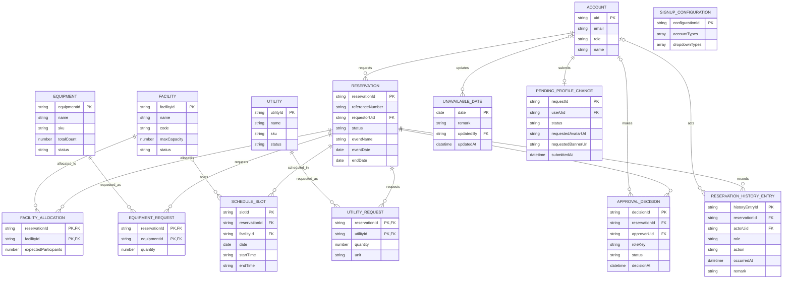
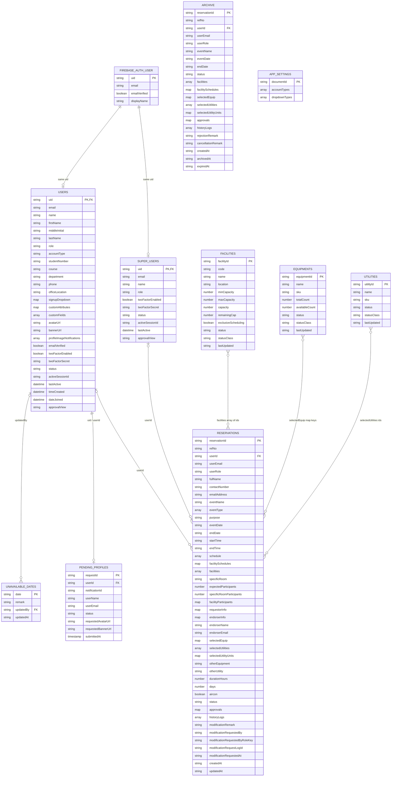

# Firestore Logical and Physical ERDs

## Scope and interpretation

These diagrams describe the data model inferred from this repository's current
client and Cloud Functions code. They are a static code scan, not a live export
of a Firebase project. Field types and optionality are inferred from reads and
writes, and legacy documents may differ.

The physical ERD represents Firestore collections/documents and their embedded
maps and arrays. Firestore does not enforce the cross-collection references
shown here as foreign keys; the application joins documents using IDs. The
logical ERD normalizes embedded reservation data into business entities to
show the concepts and cardinalities independently of their Firestore storage.

## Logical ERD

This model treats an active reservation and its archived copy as one
reservation concept through its lifecycle. The physical implementation moves a
reservation document from `reservations` to `archive`.

`FACILITY_ALLOCATION`, `EQUIPMENT_REQUEST`, `UTILITY_REQUEST`,
`SCHEDULE_SLOT`, `APPROVAL_DECISION`, and `RESERVATION_HISTORY_ENTRY` are
logical entities. They are currently stored inside reservation documents as
arrays/maps rather than as separate collections. `ACCOUNT` unifies regular
users and super admins conceptually; they are stored in separate collections
physically.

## Physical ERD (current Firestore layout)

The field lists show the principal fields observed in code, not an exhaustive
validation schema. Dynamic signup attributes, historical fields, and
role-specific profile fields can add more fields.

### Collection and embedding notes

- `users/{uid}` and `super_users/{uid}` are profile documents keyed by Firebase
  Authentication UID. `super_users` is checked first for super-admin accounts.
- `reservations/{reservationId}` is the active request. `archive/{reservationId}`
  receives the reservation data when it is rejected, cancelled, expired, or
  explicitly archived; the active document is deleted during that move.
- Reservation resource links are embedded: `facilities` is an array of IDs,
  `selectedEquip` is a map keyed by equipment ID and quantity, and
  `selectedUtilities` / `selectedUtilityUnits` hold utility selections.
- `schedule`, `facilitySchedules`, `facilityParticipants`, `approvals`, and
  `historyLogs` are embedded schedule, approval, and audit structures.
- `pending_profiles/{uid}` stores the latest pending profile-image change
  request. Approved/rejected image notification entries are embedded in the
  user's `profileImageNotifications` array.
- `app_settings/signupOptions` is the signup configuration document. Its
  `accountTypes` and `dropdownTypes` contain configurable signup metadata.
- Dates and timestamps are represented inconsistently in the current code
  (ISO strings, formatted strings, and Firestore timestamps). Some optional or
  legacy values also use different types, so consumers should tolerate those
  variations.
- Profile images are uploaded by the app to Cloudinary; the profile documents
  store image URLs rather than image binary data. Firebase Storage is initialized
  in the client but is not used by the inspected upload flow.
- Browser session IDs, login flags, and reservation drafts are stored in
  browser storage, not in Firestore, and are therefore outside these ERDs.
