# Overall System UML Diagram

This diagram brings the application’s major client components, domain
services, Firebase resources, and external integrations together in one view.
It summarizes the main relationships found in the repository and is not a
live export of the deployed Firebase project. Repeated links to Firestore
represent separate feature reads or writes, not direct links between data
collections.

```mermaid
classDiagram
    direction TB

    class App {
        +authenticate()
        +enforceTwoFactor()
        +routeByRole()
    }
    class Login
    class TwoFactorGate {
        +setupTOTP()
        +verifyTOTP()
    }
    class SideBar
    class TopBar
    class RoleRouters

    class Dashboard {
        +readReservations()
        +readArchive()
        +aggregateUsage()
    }
    class Reservation {
        +createOrUpdateReservation()
        +validateSchedule()
        +selectResources()
    }
    class ReservationDetails {
        +displayReservation()
        +renderDynamicAttributes()
        +exportPDF()
    }
    class Approval {
        +approveOrReject()
    }
    class PendingRequest {
        +resubmitOrCancel()
    }
    class Schedule
    class Calendar {
        +displayEvents()
        +displayArchive()
        +manageUnavailableDates()
    }
    class Profile {
        +updateProfile()
    }
    class FacilityManagement
    class EquipmentManagement
    class UserManagement

    class ReservationConflicts
    class ReservationTime
    class FacilityCapacity
    class ReservationExpiration
    class ArchiveReservation {
        +copyToArchive()
        +deleteActiveReservation()
    }
    class ApprovalWorkflow
    class ApprovalNotifications
    class SignupOptions {
        +loadConfiguration()
        +resolveDynamicAttributes()
    }
    class AirconSchedule
    class UnavailableDates
    class BrowserSession
    class EmailService

    class FirebaseAuth
    class CloudFirestore
    class FirebaseStorage
    class CloudFunctions
    class BrowserStorage {
        +localStorage
        +sessionStorage
        +WebLocks
    }
    class EmailJS
    class TOTPAuthenticator
    class PDFOutput

    class users
    class super_users
    class reservations
    class archive
    class facilities
    class equipments
    class utilities
    class unavailableDates
    class app_settings
    class pending_profiles

    App --> Login : unauthenticated
    App --> TwoFactorGate : setup or verify
    App --> SideBar : authenticated shell
    App --> TopBar : authenticated shell
    App --> RoleRouters : role-aware routes
    RoleRouters --> Dashboard
    RoleRouters --> Reservation
    RoleRouters --> Approval
    RoleRouters --> Schedule
    RoleRouters --> Calendar
    RoleRouters --> Profile
    RoleRouters --> FacilityManagement
    RoleRouters --> EquipmentManagement
    RoleRouters --> UserManagement
    Approval --> PendingRequest : render selected request
    TopBar --> PendingRequest : render request details

    Login --> FirebaseAuth : sign in
    App --> FirebaseAuth : auth state
    App --> CloudFirestore : load role and profile
    TwoFactorGate --> CloudFirestore : save TOTP settings
    TwoFactorGate --> TOTPAuthenticator : generate and validate codes
    App --> BrowserStorage : single-tab session controls
    BrowserSession --> BrowserStorage : lock and clear session state

    Dashboard --> CloudFirestore : analytics reads
    Reservation --> CloudFirestore : create or update
    ReservationDetails --> CloudFirestore : read reservation details
    Approval --> CloudFirestore : update status and history
    PendingRequest --> CloudFirestore : update or archive
    Schedule --> CloudFirestore : reservation lifecycle
    Calendar --> CloudFirestore : events and unavailable dates
    Profile --> CloudFirestore : profile and pending changes
    Profile --> FirebaseStorage : profile media
    FacilityManagement --> CloudFirestore : facility CRUD
    EquipmentManagement --> CloudFirestore : equipment CRUD
    UserManagement --> CloudFirestore : user management
    TopBar --> CloudFirestore : notifications and activity

    Reservation ..> ReservationConflicts : detect overlaps
    Reservation ..> ReservationTime : validate schedule
    Reservation ..> FacilityCapacity : validate participants
    Reservation ..> SignupOptions : dynamic form data
    Reservation ..> UnavailableDates : check blocked dates
    Reservation ..> ApprovalNotifications : notify next approver
    ReservationDetails ..> SignupOptions : render dynamic fields
    ReservationDetails ..> AirconSchedule : summarize HVAC schedule
    ReservationDetails ..> PDFOutput : generate PDF
    Approval ..> ApprovalWorkflow : resolve approval steps
    ApprovalNotifications ..> ApprovalWorkflow : find next approver
    ApprovalNotifications ..> EmailService : send approval notice
    EmailService ..> EmailJS : disabled by current feature flag
    PendingRequest ..> ArchiveReservation : archive lifecycle
    Schedule ..> ArchiveReservation : archive lifecycle
    ReservationExpiration ..> ArchiveReservation : archive expired records

    ArchiveReservation --> reservations : delete source document
    ArchiveReservation --> archive : copy reservation document
    Dashboard --> reservations : active data
    Dashboard --> archive : archived history and approved analytics
    Dashboard --> users : role-aware user data
    Dashboard --> facilities : facility analytics
    Dashboard --> equipments : equipment analytics
    Dashboard --> utilities : utility analytics
    Dashboard --> unavailableDates : calendar availability
    Dashboard --> pending_profiles : profile review queue
    Calendar --> reservations : active events
    Calendar --> archive : archived events
    Calendar --> app_settings : signup configuration
    Reservation --> app_settings : signup configuration
    Profile --> pending_profiles : submit profile changes

    FirebaseAuth --> users : regular account identity
    FirebaseAuth --> super_users : super-admin identity
    CloudFunctions ..> reservations : Firestore write trigger
    CloudFunctions ..> facilities : update remaining capacity
    FacilityCapacity ..> reservations : calculate usage
    FacilityCapacity ..> facilities : read capacity
```

## Reading the diagram

- The client starts at `App`, authenticates the user, optionally verifies
  two-factor authentication, and selects role-aware routes.
- Reservation, approval, calendar, and dashboard features call domain services
  for validation, workflow, archive, and reporting behavior.
- Firebase Authentication identifies users; Firestore stores application
  records; Firebase Storage stores profile media; Cloud Functions update
  facility capacity in response to reservation changes.
- Active reservations are stored in `reservations`. Archiving copies them to
  `archive` and removes the active document; dashboards and calendar views
  consume those sources according to their respective behavior.
- EmailJS sending is currently disabled by the application feature flag. PDF
  output and TOTP verification are client-side integrations.
