# Overall System UML Diagram

This diagram showed how the client interface, domain workflows, Firebase
services, stored records, and external integrations worked together. It
reflected the repository source rather than a live Firebase deployment.
Firestore links showed feature access, not direct links between collections.

```mermaid
classDiagram
    direction TB

    class App {
        +authenticate()
        +enforceTwoFactor()
        +routeByRole()
    }
    class Login
    class TwoFactorGate {
        +setupTOTP()
        +verifyTOTP()
    }
    class SideBar
    class TopBar
    class RoleRouters {
        +DashboardRouter
        +ReservationRouter
        +ApprovalRouter
        +CalendarRouter
        +ScheduleRouter
        +ProfileRouter
        +FacilityRouter
        +EquipmentRouter
        +UserManagementRouter
    }
    class RoleSpecificDashboardViews {
        +BuildingAdmin
        +MIS
        +OSA
        +RoomChecker
        +AcademicHead
        +SchoolAdmin
    }

    class Dashboard {
        +readReservations()
        +readArchive()
        +aggregateUsage()
    }
    class Reservation {
        +createOrUpdateReservation()
        +validateSchedule()
        +selectResources()
    }
    class ReservationDetails {
        +displayReservation()
        +renderDynamicAttributes()
        +exportPDF()
    }
    class Approval {
        +approveOrReject()
    }
    class PendingRequest {
        +resubmitOrCancel()
    }
    class Schedule
    class Calendar {
        +displayEvents()
        +displayArchive()
        +manageUnavailableDates()
    }
    class Profile {
        +updateProfile()
    }
    class FacilityManagement
    class EquipmentManagement
    class UserManagement

    class ReservationConflicts
    class ReservationTime
    class FacilityCapacity
    class ReservationExpiration
    class ArchiveReservation {
        +copyToArchive()
        +deleteActiveReservation()
    }
    class ApprovalWorkflow
    class ApprovalNotifications
    class SignupOptions {
        +loadConfiguration()
        +resolveDynamicAttributes()
    }
    class AirconSchedule
    class UnavailableDates
    class BrowserSession
    class EmailService

    class FirebaseAuth
    class CloudFirestore
    class FirebaseStorage
    class CloudFunctions
    class BrowserStorage {
        +localStorage
        +sessionStorage
        +WebLocks
    }
    class EmailJS
    class TOTPAuthenticator
    class PDFOutput

    class users
    class super_users
    class reservations
    class archive
    class facilities
    class equipments
    class utilities
    class unavailableDates
    class app_settings
    class pending_profiles

    App --> Login : unauthenticated
    App --> TwoFactorGate : setup or verify
    App --> SideBar : authenticated shell
    App --> TopBar : authenticated shell
    App --> RoleRouters : role-aware routes
    RoleRouters --> RoleSpecificDashboardViews : dashboard by role
    RoleRouters --> Dashboard
    RoleRouters --> Reservation
    RoleRouters --> Approval
    RoleRouters --> Schedule
    RoleRouters --> Calendar
    RoleRouters --> Profile
    RoleRouters --> FacilityManagement
    RoleRouters --> EquipmentManagement
    RoleRouters --> UserManagement
    Approval --> PendingRequest : render selected request
    TopBar --> PendingRequest : render request details

    Login --> FirebaseAuth : sign in
    App --> FirebaseAuth : auth state
    App --> CloudFirestore : load role and profile
    TwoFactorGate --> CloudFirestore : save TOTP settings
    TwoFactorGate --> TOTPAuthenticator : generate and validate codes
    App --> BrowserStorage : single-tab session controls
    BrowserSession --> BrowserStorage : lock and clear session state

    Dashboard --> CloudFirestore : analytics reads
    Reservation --> CloudFirestore : create or update
    ReservationDetails --> CloudFirestore : read reservation details
    Approval --> CloudFirestore : update status and history
    PendingRequest --> CloudFirestore : update or archive
    Schedule --> CloudFirestore : reservation lifecycle
    Calendar --> CloudFirestore : events and unavailable dates
    Profile --> CloudFirestore : profile and pending changes
    Profile --> FirebaseStorage : profile media
    FacilityManagement --> CloudFirestore : facility CRUD
    EquipmentManagement --> CloudFirestore : equipment CRUD
    UserManagement --> CloudFirestore : user management
    TopBar --> CloudFirestore : notifications and activity

    Reservation ..> ReservationConflicts : detect overlaps
    Reservation ..> ReservationTime : validate schedule
    Reservation ..> FacilityCapacity : validate participants
    Reservation ..> SignupOptions : dynamic form data
    Reservation ..> UnavailableDates : check blocked dates
    Reservation ..> ApprovalNotifications : notify next approver
    ReservationDetails ..> SignupOptions : render dynamic fields
    ReservationDetails ..> AirconSchedule : summarize HVAC schedule
    ReservationDetails ..> PDFOutput : generate PDF
    Approval ..> ApprovalWorkflow : resolve approval steps
    ApprovalNotifications ..> ApprovalWorkflow : find next approver
    ApprovalNotifications ..> EmailService : send approval notice
    ReservationExpiration ..> EmailService : send expiration notice
    EmailService ..> EmailJS : deliver notification email
    PendingRequest ..> ArchiveReservation : archive lifecycle
    Schedule ..> ArchiveReservation : archive lifecycle
    ReservationExpiration ..> ArchiveReservation : archive expired records
    Dashboard ..> PDFOutput : export role-specific reports
    Calendar ..> PDFOutput : export reservations

    ArchiveReservation --> reservations : delete source document
    ArchiveReservation --> archive : copy reservation document
    Dashboard --> reservations : active data
    Dashboard --> archive : archived history and approved analytics
    Dashboard --> users : role-aware user data
    Dashboard --> facilities : facility analytics
    Dashboard --> equipments : equipment analytics
    Dashboard --> utilities : utility analytics
    Dashboard --> unavailableDates : calendar availability
    Dashboard --> pending_profiles : profile review queue
    Calendar --> reservations : active events
    Calendar --> archive : archived events
    Calendar --> app_settings : signup configuration
    Reservation --> app_settings : signup configuration
    UserManagement --> app_settings : signup configuration
    Profile --> pending_profiles : submit profile changes

    FirebaseAuth --> users : regular account identity
    FirebaseAuth --> super_users : super-admin identity
    CloudFunctions ..> reservations : reservation write trigger
    CloudFunctions ..> facilities : reservation or facility write recomputes capacity
    FacilityCapacity ..> reservations : calculate active usage
    FacilityCapacity ..> facilities : recalculate and update capacity
```

## Reading the diagram

The application started at `App`, which handled sign-in, loaded the user's
role, and applied two-factor verification when required. Role-aware routes
connected users to reservation, approval, calendar, schedule, profile, and
management features. Reservation services validated schedules, conflicts,
capacity, and availability before requests entered the approval workflow.

Firestore stored user profiles, active reservations, archived reservations,
facilities, equipment, utilities, availability, and application settings.
Archiving copied a reservation from `reservations` to `archive`; dashboards
and calendars could read from both. The client and Cloud Functions recalculated
facility capacity after relevant reservation or facility changes, while
Firebase Storage held profile media.

Approval and expiration notifications passed through EmailJS, with the monthly
send allowance monitored by the email service. Reservation details, calendars,
and role-specific dashboards produced PDF exports, and TOTP setup and
verification ran in the client. UML classes grouped related responsibilities
for readability; they did not imply that each class was a separately deployed
service.
