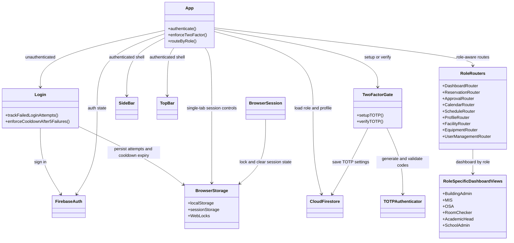
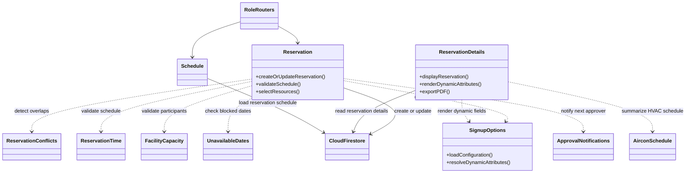
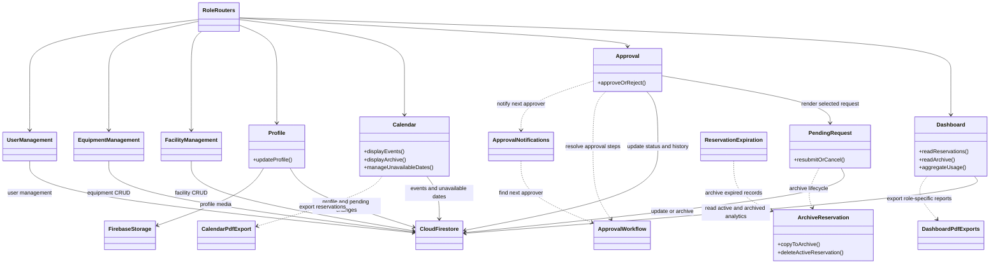
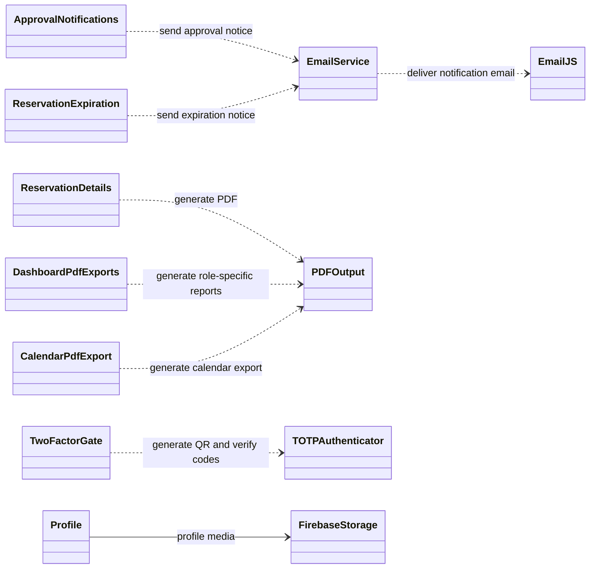

# System UML Diagram (Mermaid)

This diagram explained how the client application, domain workflows, Firebase
services, and stored records worked together. It reflected the repository
source, not a live Firebase export; security rules and deployed settings were
not shown. Some components appeared in multiple segments to make their
separate relationships clear.

The system was split into five segments.

## Segment 1: Client application and routing

This segment showed how users signed in and completed two-factor verification
when required. The app read each user's role and opened the routes and
dashboard available to them. Firebase Auth kept sessions per tab, while
browser storage and Web Locks helped control access for the same account.
Login also tracked failed attempts in the current tab and imposed a
60-second cooldown after five failed attempts.

## Segment 2: Reservation request and scheduling

This segment showed how users created reservations and managed schedules.
Conflict, time, facility-capacity, and unavailable-date services validated
each request before it was saved. Signup configuration supplied dynamic
fields, approval notifications alerted the next approver, and the details
view displayed saved request data and air-conditioning schedules.

## Segment 3: Approval, archive, and dashboard operations

This segment showed how sequential approvals, request changes, and archiving
worked together. Pending requests past their start time and approved
reservations that had ended could be archived. Dashboards and calendars could
access active and archived records, and role-based dashboards exported PDF
reports.

## Segment 4: Firebase data and reservation lifecycle

This segment showed how application features used Firebase collections.
Archiving copied a reservation to `archive` and removed it from
`reservations`, while dashboards and calendars read active and archived
records. The client and Cloud Functions updated facility capacity after
relevant reservation or facility-capacity changes.

```mermaid
classDiagram
    direction TB

    class FirebaseAuth
    class CloudFirestore
    class CloudFunctions
    class Dashboard
    class Reservation
    class Calendar
    class Profile
    class ArchiveReservation
    class FacilityCapacity
    class SignupOptions
    class UserManagement
    class users
    class super_users
    class reservations
    class archive
    class facilities
    class equipments
    class utilities
    class unavailableDates
    class app_settings
    class pending_profiles

    Dashboard --> CloudFirestore : live reads
    Reservation --> CloudFirestore : create and update
    Calendar --> CloudFirestore : live reads
    Profile --> CloudFirestore : profile updates
    ArchiveReservation --> reservations : delete source document
    ArchiveReservation --> archive : copy reservation document
    Dashboard --> reservations : active data
    Dashboard --> archive : archived history and approved analytics
    Calendar --> reservations : active events
    Calendar --> archive : archived events

    FirebaseAuth --> users : regular account identity
    FirebaseAuth --> super_users : super-admin identity
    Dashboard --> users : role-aware user data
    Dashboard --> equipments : equipment analytics
    Dashboard --> utilities : utility analytics
    Dashboard --> facilities : facility analytics
    Dashboard --> unavailableDates : calendar availability
    Dashboard --> pending_profiles : profile review queue
    Reservation --> app_settings : signup configuration
    Calendar --> app_settings : signup configuration
    UserManagement --> app_settings : signup configuration
    Profile --> pending_profiles : submit profile changes

    CloudFunctions ..> reservations : reservation write trigger
    CloudFunctions ..> facilities : recompute remaining capacity
    FacilityCapacity ..> reservations : calculate active usage
    FacilityCapacity ..> facilities : recalculate and update capacity
    SignupOptions --> app_settings : read configuration
```

## Segment 5: External services and generated outputs

This segment showed the integrations and outputs connected to the main
reservation flow. EmailJS handled approval and expiration notifications; the
client generated and verified TOTP codes, stored profile media in Firebase
Storage, and exported reservation, calendar, and role-specific dashboard PDFs.

## Main data and lifecycle notes

Active reservations were stored in `reservations`. When archived, a
reservation was copied to `archive` with an `archivedAt` value, then removed
from the active collection. Reservation documents also contained their
schedules, resource selections, approval records, dynamic requestor and
endorser fields, and history logs.

The client used Firebase Auth with per-tab persistence, Firestore, and
Firebase Storage. The client and Cloud Functions updated facility capacity.
EmailJS handled approval and expiration notices, and the email service
monitored the monthly send allowance. Reservation details, calendars, and
role-specific dashboards exported PDFs; TOTP codes were generated and verified
in the client.
