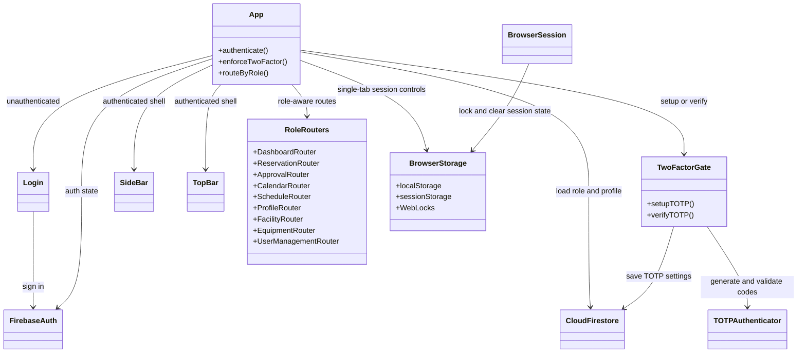
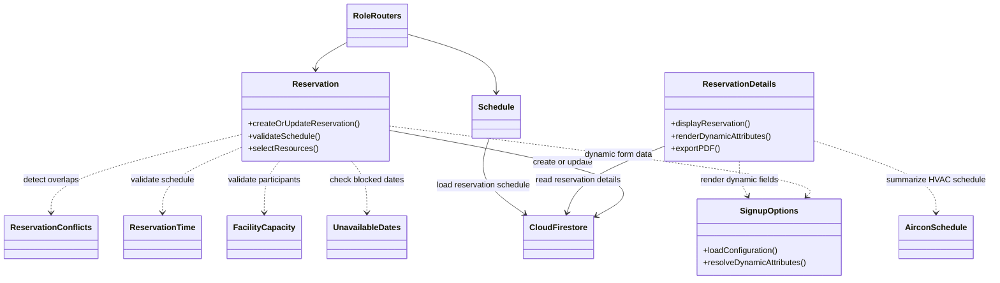
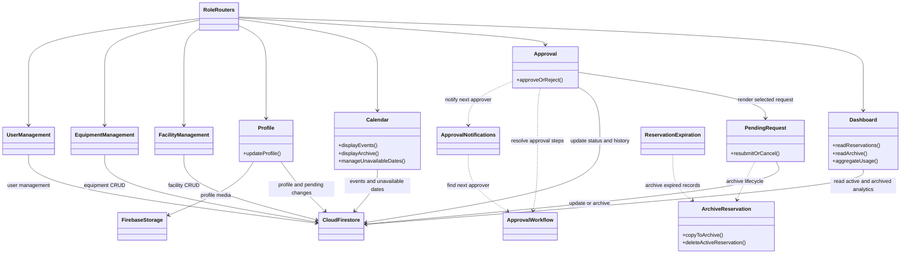
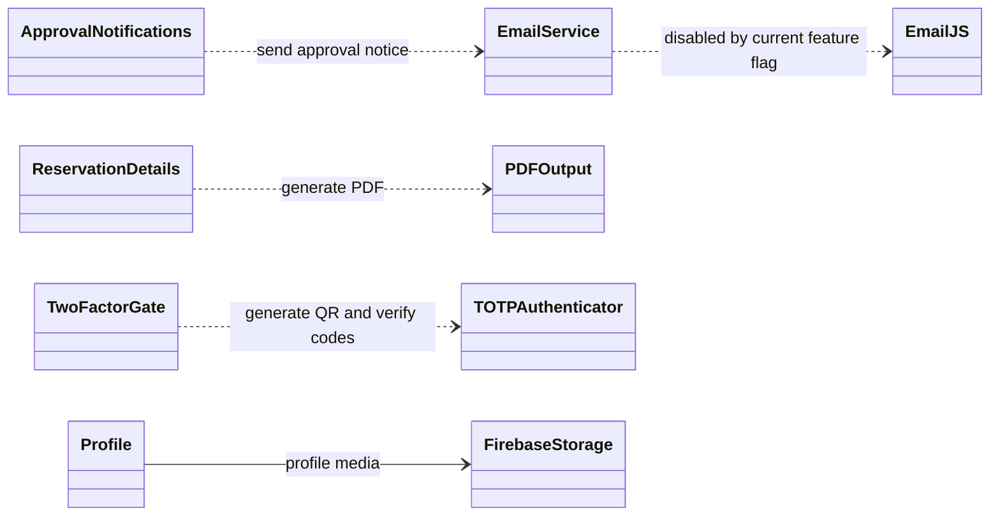

# System UML Diagram (Mermaid)

This diagram summarizes the application architecture inferred from the source
code. It is a static repository scan, not a live Firebase configuration
export. Firestore collection names and component boundaries are based on the
client and Cloud Functions code. Firestore security rules and deployed service
configuration are outside this diagram's scope.

The system view is split into five UML segments. Some components recur across
diagrams to show their different relationships clearly.

## Segment 1: Client application and routing

This segment shows how users enter the application and how authentication and
two-factor verification protect access. The app loads the user's role and
selects the appropriate route set after sign-in. Browser storage and Web Locks
help keep sessions isolated between tabs.

## Segment 2: Reservation request and scheduling

This segment shows the reservation creation and schedule-management path.
Conflict, time, capacity, and unavailable-date services validate the request
before it is stored. Signup configuration supplies dynamic fields, while the
details view formats the saved reservation and its air-conditioning schedule.

## Segment 3: Approval, archive, and dashboard operations

This segment shows how approval decisions and request changes are handled.
Pending and expired reservations can be moved into the archive, and dashboard
analytics can read active and archived records. The same routed area also
includes calendar, profile, and facility, equipment, and user management.

## Segment 4: Firebase data and reservation lifecycle

This segment maps the main application features to Firebase data collections.
Reservations move from the active collection to the archive when archived,
while dashboards and calendars read from both sources for their respective
views. Cloud Functions observe reservation writes and update facility
remaining-capacity data.

```mermaid
classDiagram
    direction TB

    class FirebaseAuth
    class CloudFirestore
    class CloudFunctions
    class Dashboard
    class Reservation
    class Calendar
    class Profile
    class ArchiveReservation
    class FacilityCapacity
    class users
    class super_users
    class reservations
    class archive
    class facilities
    class equipments
    class utilities
    class unavailableDates
    class app_settings
    class pending_profiles

    Dashboard --> CloudFirestore : live reads
    Reservation --> CloudFirestore : create and update
    Calendar --> CloudFirestore : live reads
    Profile --> CloudFirestore : profile updates
    ArchiveReservation --> reservations : delete source document
    ArchiveReservation --> archive : copy reservation document
    Dashboard --> reservations : active data
    Dashboard --> archive : archived history and approved analytics
    Calendar --> reservations : active events
    Calendar --> archive : archived events

    FirebaseAuth --> users : regular account identity
    FirebaseAuth --> super_users : super-admin identity
    Dashboard --> users : role-aware user data
    Dashboard --> equipments : equipment analytics
    Dashboard --> utilities : utility analytics
    Dashboard --> facilities : facility analytics
    Dashboard --> unavailableDates : calendar availability
    Dashboard --> pending_profiles : profile review queue
    Reservation --> app_settings : signup configuration
    Calendar --> app_settings : signup configuration
    Profile --> pending_profiles : submit profile changes

    CloudFunctions ..> reservations : Firestore write trigger
    CloudFunctions ..> facilities : update remaining capacity
    FacilityCapacity ..> reservations : calculate usage
    FacilityCapacity ..> facilities : read capacity
```

## Segment 5: External services and generated outputs

This segment summarizes integrations outside the main reservation data flow.
Approval notifications pass through the email service, though its current
feature flag disables EmailJS sending. The client also generates and verifies
TOTP codes, stores profile media, and exports reservation details as PDFs.

## Main data and lifecycle notes

- Reservations are stored in `reservations` while active. `ArchiveReservation`
  copies a document to `archive` and deletes the active document; archive
  documents retain their reservation fields and receive `archivedAt`.
- Reservation documents embed schedule entries, facility-specific schedules,
  equipment and utility selections, approval records, dynamic requestor and
  endorser attributes, and history logs. These are not separate collections.
- The client uses Firebase Authentication, Cloud Firestore, and Firebase
  Storage. Cloud Functions use the Admin SDK and react to Firestore writes to
  maintain facility remaining capacity.
- Email notification calls pass through `EmailService`; its current
  `EMAILJS_ENABLED` flag is `false`, so EmailJS sends are disabled.
- `ReservationDetails` uses `html2pdf.js` for PDF output. Two-factor codes are
  generated and verified in the client using TOTP/QR-code libraries.
